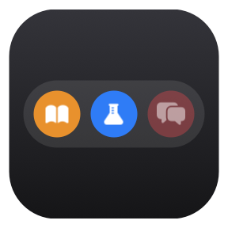
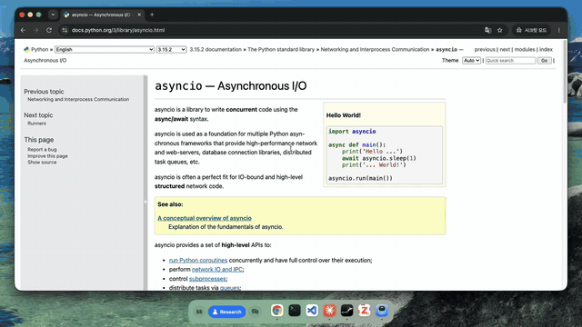
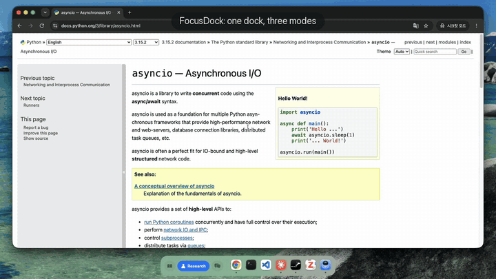
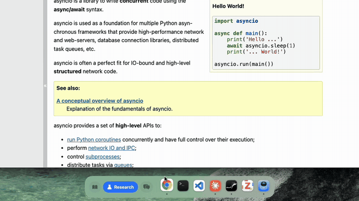
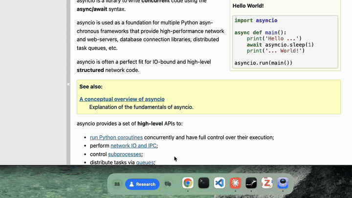
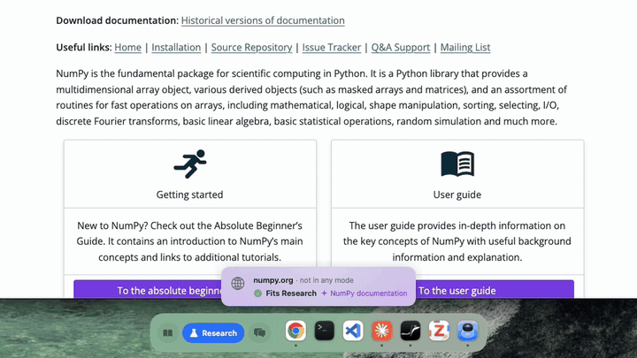

<p align="center"></p>

<h1 align="center">FocusDock</h1>

<p align="center"><b>Pick a mode. Stay in it.</b><br>
A floating dock for macOS that holds back distracting apps, sites and messages while you study or do research,
with Google DeepMind's <a href="https://huggingface.co/google/embeddinggemma-300m">EmbeddingGemma</a> running on your Mac.</p>

<p align="center"><a href="https://github.com/yonghdong/FocusDock/releases/latest"><b>Download for Mac</b></a> ·
<a href="docs/media/demo.mp4"><b>Full demo (58 s)</b></a> ·
<a href="#how-it-works"><b>How it works</b></a><br>
<sub>Free and open source. Everything runs on your Mac. No account, no API key.</sub></p>

<p align="center">
<a href="https://github.com/yonghdong/FocusDock/stargazers"></a>
<a href="LICENSE"></a>


</p>

<p align="center"></p>

Most focus tools block things. FocusDock makes them slower instead. It's a dock that floats at the bottom of your
screen and shows one mode at a time: Study, Research or Social. While you're in Study or Research, Social apps, sites
and messages are held back, and getting to them means waiting out a short countdown that can't be skipped. The
distracted choice is still there; it's just slower than the focused one.

The judgment calls happen on your Mac, with EmbeddingGemma, a 300M-parameter embedding model: whether a site you've
never opened belongs to Research or to Social, and whether a Slack message is urgent enough to interrupt you. It
learns from what you press, and when it isn't sure, it asks instead of guessing.

The idea comes from [a demo Thariq shared](https://x.com/trq212/status/2115135857669881939) of an AI-native macOS dock
with custom modes. FocusDock is an independent take on it that runs entirely on your Mac.

## What it does

- Press **Social** in Research and a 15-second countdown starts next to **Stay**. Pressing again doesn't make it
  shorter
- Open x.com in Research and the page blurs under a card: **Stay** goes back, **Go to Social** starts the countdown
- Open numpy.org for the first time and a small **Fits Research** toast says it's fine. A login page or your bank gets
  a question instead of a guess
- "can you review this before the 4pm meeting?" on Slack shows up as a card held for Social. "30% off this weekend"
  waits until you get there
- ⌘Tab to Slack while you're in Research and it hides again
- Go from Study to Research and your windows follow: Research's apps come back, the others hide, and the app you last
  used there comes to the front

It learns from you. **👎** on a card means messages like that stay quiet from now on, **☆** makes the sender a VIP whose
messages always get through, and every app or site you put in a mode helps it sort the next new one.

<sub>The demo is a real recording. Its messages were sent with `osascript`, which is why the cards say Script Editor;
Slack or KakaoTalk messages look the same.</sub>

## Private

With the default settings, nothing leaves your Mac: not your notifications, not the sites you visit, not what you
press. FocusDock goes online only to download the embedding model once (318 MB, from Hugging Face), and to star this
repository through your GitHub CLI if you press Star on GitHub on its welcome card. No account, no telemetry.

Asking Claude about the messages FocusDock can't decide is an option you turn on yourself, and only those messages go
out. More in [Private, in detail](#private-in-detail).

## Install

It needs an Apple Silicon Mac (M1 or later) with macOS 13 or later, and it's developed and tested on macOS 26. The
first launch downloads the embedding model (318 MB, once).

**One line in Terminal** quits FocusDock if it's running, downloads it into Applications and opens it. It also updates
an installed copy. Files downloaded in Terminal aren't flagged by macOS, so there's no warning to click through:

```sh
pkill -x FocusDock; curl -fsSL https://github.com/yonghdong/FocusDock/releases/latest/download/FocusDock.zip -o /tmp/FocusDock.zip && ditto -x -k /tmp/FocusDock.zip /Applications && open /Applications/FocusDock.app
```

**Or download it.** Get `FocusDock.dmg` from [Releases](https://github.com/yonghdong/FocusDock/releases/latest), open
it, and drag FocusDock to Applications. FocusDock isn't notarized by Apple, so the first time you open it, macOS says
*"FocusDock" Not Opened*: click **Done**, then in System Settings → Privacy & Security scroll down to *"FocusDock" was
blocked* and click **Open Anyway**. If that doesn't show up, run `xattr -dr com.apple.quarantine /Applications/FocusDock.app` once.

**Or build it yourself**, with Swift 5.9 or later from Xcode or just the Command Line Tools
(`xcode-select --install`):

```sh
git clone https://github.com/yonghdong/FocusDock.git && cd FocusDock
./scripts/build-app.sh            # → build/FocusDock.app (about 32 MB)
mv build/FocusDock.app /Applications/ && open /Applications/FocusDock.app
```

The script builds a release binary, downloads llama.cpp release `b12038` for macOS arm64 (17 MB), checks it against a
pinned SHA-256, puts its `llama-server` in the app and signs the app ad hoc. Building with the macOS 26 SDK, as the
Releases build is, also includes Apple's on-device model as a fallback.

FocusDock has no icon in the macOS Dock. It lives in its own dock at the bottom of the screen and in the menu bar, as
the current mode's name. From then on it opens when you log in; **Open at Login** in the menu bar (or Setup →
Permissions) turns that off. One optional extra: turn on **Automatically hide and show the Dock** (System Settings →
Desktop & Dock) so the macOS Dock doesn't sit on top of it.

Then, in the **Setup** window that opens by itself (on the first launch, and after an update while Full Disk Access is
missing):

1. **Permissions.** FocusDock needs **Full Disk Access** to read the notification history, and macOS doesn't list it
   there by itself, so you add it: click **Open Settings** (System Settings → Privacy & Security → Full Disk Access),
   click **+** under the list, enter your password, choose **FocusDock** in Applications, and make sure its switch is
   on. FocusDock notices within 5 seconds, no restart needed. **Automation** is asked the first time FocusDock looks
   at each browser ("FocusDock wants to control Google Chrome"): click **Allow**.
2. **Do Not Disturb.** Click **Create Shortcuts** and **Add Shortcut** twice in the Shortcuts app, then tick the modes
   that should hide banners (Study and Research). This needs you to be signed in to iCloud, because macOS signs
   shortcuts with your account.
3. **Apps and Sites.** The defaults cover common apps and sites ([listed below](#configuration)). Put your own in one
   or more modes, hide apps from the dock with the eye icon, or let **Suggest for unplaced apps** sort the rest.
4. **Notifications.** Add VIPs. *Who decides* stays on **This Mac only** unless you want Claude's help. The model
   download shows its progress here.

Click **Done**. Everything can be changed or undone later from the menu bar's **Setup…**

**Updating.** Quit FocusDock from the menu bar, then run the Terminal line again or replace the app with the new
download (from source: `git pull && ./scripts/build-app.sh`). Your settings are kept. macOS sees each version as a new
app, so in Full Disk Access remove FocusDock with **−** and add it again with **+** (Setup opens by itself to walk you
through it), and allow Automation again if asked.

## Using it

Click a mode in the dock or the menu bar. Everything else comes to you as a card:

| Card | What you can do |
|---|---|
| *Social 0:15* | **Stay** cancels the switch. |
| *x.com · belongs to Social* | **Stay** goes back to the last allowed page. **Go to Social** starts the countdown. |
| *docs.example.com · not in any mode · Fits Research* | Nothing: it's allowed and remembered. |
| *Prof. Kim · Slack · held for Social* | **Later** dismisses it. **Go to Social** switches. **☆** makes the sender a VIP. **👎** means "not urgent, keep messages like this quiet". |
| *Should messages like this reach you while you focus?* | **Important** or **Not important**. FocusDock remembers. |
| *kaggle.com · belongs to Research*, in Study | **Belongs in Study** fixes FocusDock's guess. |

The menu bar has **Recently Learned**, where you can move or remove recent guesses, and Setup's Apps and Sites tabs
change anything. One thing is deliberately harder: moving something that is, or was, in Social into Study or Research
works only in Setup, after the same 30-second wait as going to Social. Otherwise fixing a guess would be a faster way to
Social than Social itself.

To tidy the dock, right-click an icon → **Hide from Dock**; the eye icon in Setup → Apps brings it back. Apps that
aren't installed never show up.

## The wait

<p align="center"></p>

| From | To Social |
|---|---|
| Study | 30 s |
| Research | 15 s |
| Study ⇄ Research, or leaving Social | instant |

The wait can't be skipped or shortened, only cancelled. You can change the times per mode in the config.

## Sites from other modes

<p align="center"></p>

FocusDock looks at the current tab in Chrome, Safari, Arc, Brave and Edge twice a second. A site from another mode gets
blurred under a card. The tabs and the address bar still work, so you can go somewhere else. **Stay** sends the tab back
to the last allowed page, or closes it if there isn't one yet (right after switching modes, say). **Go to Social**
keeps the page blurred until the countdown ends.

Apps work the same way. Reach one from another mode (⌘Tab, Spotlight, the macOS Dock) and it hides again and asks.

## New apps and sites

<p align="center"></p>

When an app or site isn't in any mode yet, EmbeddingGemma compares it with what's already in each mode: its apps, its
sites and a sentence about what it's for. If it clearly fits the current mode you get a **Fits** toast and carry on; if
it clearly belongs to another, you get the card. The answer is saved, so each app or site is checked once.

It's careful in two ways. Login, email, banking and shopping pages fit no mode, so they aren't pulled into one. And
something goes to Social only when it clearly belongs there, because a wrong Social guess blocks a page you needed.
When it isn't sure, you get a card asking instead.

On a test of 70 apps and sites:

| | Right | Asked | Wrong focus mode | Wrongly in Social |
|---|---|---|---|---|
| EmbeddingGemma (FocusDock's default) | 56 | 9 | 5 | **0** |
| Apple's on-device model | 49 | 5 | 10 | **6** |

## Messages

<p align="center"></p>

When a message comes in from another mode's app (Slack, Messages, KakaoTalk or Discord, while you're in Research),
FocusDock decides whether it's urgent:

- **Urgent** (a direct question with a deadline, someone waiting on you, "lunch in 10?") shows up as a card held for
  Social. Cards stack, up to three with a count of the earlier ones, and the Social button shows how many are waiting
- **Everything else** waits quietly until you go to Social
- **VIPs** always get through, in any mode, from any app

It decides on your Mac, in this order:

1. **Rules.** VIPs always show. An invitation to eat together today ("lunch?", "저녁 먹으러 갈 사람?") is urgent.
2. **Your reactions.** Every Important, Not important, 👎 and Go to is stored with an embedding of the message. A new
   message that is clearly closer to the ones you called important than to the ones you didn't, or the other way
   around, is decided right away. English and Korean share one embedding space, so a reaction in one covers the other.
3. **Built-in examples.** Two dozen generic examples in English and Korean ("can you review this before the 4pm
   meeting?" against "30% off this weekend"), with a stricter bar. They handle the obvious cases from day one.
4. **Ask you.** If it's still unclear, a small card asks whether messages like this should reach you, and the answer
   goes into step 2. The same sender is asked at most once every 30 minutes, and the question goes away after 20
   seconds.

With Do Not Disturb on in focus modes, the usual macOS banners stay away, so these cards are the only interruptions
you see.

## How it works

```
the app in front,      ─► in this mode? ─────────► nothing happens
the browser tab (2×/s) ─► in another mode? ──────► card, page blurred
                       ─► in no mode yet? ───────► EmbeddingGemma: nearest examples per mode
                                                   ─► Fits toast, card, or a question
a new notification     ─► from another mode's app?
(macOS history)        ─► VIP, your reactions, built-in examples ─► card held for Social, quiet, or a question

EmbeddingGemma 300M (8-bit, 318 MB) on llama.cpp, in a helper on 127.0.0.1 that quits after 10 idle minutes
```

macOS doesn't let one app intercept another's notifications, so FocusDock splits the job in two. Do Not Disturb, set
through two Shortcuts FocusDock creates, keeps banners away while you focus. FocusDock reads the notification history
(`~/Library/Group Containers/group.com.apple.usernoted/db2/db`, which is why it needs Full Disk Access) and decides
which messages deserve a card. macOS writes a notification there 5 to 10 seconds after it arrives, so cards trail the
message by about that much.

The embeddings come from ggml-org's 8-bit build of
[EmbeddingGemma 300M](https://huggingface.co/ggml-org/embeddinggemma-300M-GGUF), checked against a pinned SHA-256 and
run by the `llama-server` from [llama.cpp](https://github.com/ggml-org/llama.cpp) that ships inside the app. The server
listens on 127.0.0.1 only, starts when something needs a decision, takes about 0.03 s per embedding and about 450 MB
while it runs, and quits after 10 idle minutes.

To sort a new app or site, FocusDock scores each mode by the average similarity of its two closest examples. The best
mode has to beat the runner-up by a margin, a wider one for Social, or FocusDock asks. A group of examples for things
that fit no mode (sign-in pages, mail, banking, shopping, maps) competes like a mode. Until the model has downloaded,
Apple's on-device model fills in where it's available.

**Optional: let Claude decide the unclear messages.** In Setup → Notifications, **Ask Claude when unsure** sends only
the messages FocusDock couldn't decide to Claude Haiku through your installed
[Claude Code](https://claude.com/claude-code) (`claude -p`, no tools, no MCP servers, no saved session). It uses your
Claude Code login, so there's no API key to set. In this mode Haiku also keeps a short note of your preferences,
rewritten every 5 reactions, which you can read and edit in Setup.

## Private, in detail

- With the default settings, nothing leaves your Mac. Notifications, reactions and the model all stay local.
- Notification text leaves your Mac only if you turn on *Ask Claude when unsure*, and then only for the messages
  FocusDock couldn't decide, or if you set `triageProvider` to a cloud provider in the config.
- Sorting new apps and sites stays on your Mac by default. The optional `jev` and `claude` providers send the app's
  name, or the site's domain and page title, to their APIs.
- Everything FocusDock keeps is in `~/Library/Application Support/FocusDock/`: `config.json`, `reactions.json` and
  the model.

## Configuration

Menu bar → **Edit Config…** opens `~/Library/Application Support/FocusDock/config.json`, and **Reload Config** applies
your edits. Setup covers most of it.

| Key | Meaning |
|---|---|
| `modes[].apps` | Bundle IDs (find one with `osascript -e 'id of app "Notion"'`) |
| `modes[].domains` | Domains; subdomains match |
| `modes[].purpose` | A sentence about what the mode is for, used when sorting new apps and sites |
| `modes[].exit` | `defaultDelay` and per-target `delays` in seconds, e.g. `{"social": 30}` |
| `modes[].shortcut` | The shortcut to run on entering the mode (Setup → Do Not Disturb fills it in) |
| `classifier.provider` | Sorts new apps and sites: `local` (default: EmbeddingGemma, Apple's model until it has downloaded), `apple` (Apple's on-device model, macOS 26), `jev` ([TypeSafe](https://docs.typesafe.ai), needs `typesafeAPIKey`), `claude` (needs `anthropicAPIKey`), `auto` (local, then jev, apple, claude) or `off` |
| `classifier.minConfidence` | For `jev`: below this confidence (default 0.5) a guess counts as "fits no mode" |
| `classifier.triageProvider` | Messages: `local` (default, This Mac only), `auto` (ask Claude when unsure), `off` (never ask). `claudeCode`, `apple`, `jev` and `claude` pick one model for the unclear ones |
| `vips`, `dockHidden`, `learned` | Managed by Setup and the cards |
| `hideOtherAppsOnEnter`, `launchAppsOnEnter` | What entering a mode does |

The default modes:

- **Study**: Notion, Notes, Preview, GoodNotes, Anki, Claude, Chrome. Google Docs, Notion, Overleaf, arXiv,
  Wikipedia, Coursera, edX, Khan Academy, KAIST KLMS.
- **Research**: Xcode, VS Code, Cursor, Zed, Terminal, Ghostty, PyCharm, MATLAB, Zotero, Skim, Preview, GitHub
  Desktop, Claude, Chrome. GitHub, Stack Overflow, Python and PyTorch docs, arXiv, Google Scholar, Semantic Scholar,
  OpenReview, Overleaf, Hugging Face, W&B, Google Calendar.
- **Social**: Slack, Messages, Discord, KakaoTalk, Chrome. X, Instagram, YouTube, Reddit, Facebook, Hacker News.

## Build from source

The last of the [Install](#install) options builds the app. For working on it:

```sh
swift build                       # debug build
./scripts/test.sh                 # unit tests (Swift Testing, needs Swift 6; works with the Command Line Tools alone)
./scripts/build-app.sh            # release .app with the bundled llama-server
./scripts/package.sh              # FocusDock.dmg and FocusDock.zip for a release
GEMMA_LIVE=1 ./scripts/test.sh --filter ModeMatcherLiveTests   # the 70-item sorting test with the real model
/usr/bin/log stream --predicate 'process == "FocusDock"' --level debug
```

All the logic lives in `Sources/FocusDockKit`, covered by tests in `Tests/FocusDockKitTests`.

## FAQ

**How is this different from macOS Focus or Screen Time?** Focus silences notifications and Screen Time sets limits.
FocusDock adds a wait before you switch, sorts sites and apps you've never opened, and lets urgent messages through,
judged by what they say. It uses Do Not Disturb for the banners, so the two work side by side.

**Can I get around it?** Yes. The blur is a window on top of the page, and you can always quit FocusDock. It's a speed
bump, not a lock.

**Why does it need Full Disk Access?** To read the notification history, the only place macOS lets an app see other
apps' notifications. FocusDock uses that access for that one database.

**Why is the download 318 MB?** That's EmbeddingGemma, downloaded once on first launch. The app itself is about 32 MB.

**Will it slow my Mac down?** The model runs in a helper process only while something needs a decision (about 450 MB
of memory), and quits after 10 idle minutes.

**Which browsers?** Chrome, Safari, Arc, Brave and Edge. Firefox has no AppleScript support for reading tabs.

**Which languages?** Messages and reactions work in English and Korean, the two FocusDock was tested with. The model
knows more than 100 languages, but the built-in examples are only in those two.

**Why isn't a message showing up?** FocusDock sees a message only after macOS records it, and only what the
notification shows: some apps hide the sender or the text in group chats.

**Why did a site I've never opened get a question?** Sorting knows what's in your modes, not the whole web. A site with
an unfamiliar name and a vague title gets a question instead of a guess. Answer it once, and similar sites get easier.

**Something isn't working?**

| Problem | Fix |
|---|---|
| No message cards, and the menu bar says *Notifications: needs Full Disk Access…* | Add FocusDock under Full Disk Access with **+** (Setup → Permissions walks you through it). After an update, remove it with **−** and add it again. |
| Sites aren't noticed, or Stay doesn't send the tab back | Allow FocusDock under System Settings → Privacy & Security → Automation for that browser. |
| New sites always say *not in any mode* | Wait for the model download (Setup → Notifications shows it). Before that, FocusDock falls back to Apple's model, which needs Apple Intelligence. Also check `classifier.provider`. |
| macOS keeps saying *"FocusDock" Not Opened* | Run `xattr -dr com.apple.quarantine /Applications/FocusDock.app` once, or use the Terminal install line. |
| *Create Shortcuts* says signing failed | Sign in to iCloud in System Settings, then try again. |
| Do Not Disturb doesn't change with the mode | Run *FocusDock DND On* once by hand in the Shortcuts app, and allow it if macOS asks. |
| A site or app went to the wrong mode | Use the card's **Belongs in …**, the menu bar's **Recently Learned**, or Setup → Apps / Sites. |

**How do I remove it?** Turn off **Open at Login** and quit it, both in the menu bar, then delete `/Applications/FocusDock.app` and
`~/Library/Application Support/FocusDock` (settings, reactions and the model). Run `defaults delete com.focusdock.app`
for the rest of its settings, delete *FocusDock DND On* and *FocusDock DND Off* in the Shortcuts app, and remove
FocusDock from Full Disk Access and Automation in System Settings → Privacy & Security.

## Thanks

The modes, the exit countdown, the "belongs to Social" cards and the messages held for Social all started with
[Thariq's post](https://x.com/trq212/status/2115135857669881939) about a personal macOS dock with custom modes.

FocusDock is built on [EmbeddingGemma](https://ai.google.dev/gemma/docs/embeddinggemma) by Google DeepMind, used under
the [Gemma Terms of Use](https://ai.google.dev/gemma/terms) and downloaded on first launch rather than shipped with the
app, and [llama.cpp](https://github.com/ggml-org/llama.cpp) (MIT), whose `llama-server` ships inside the app. Apple's
Foundation Models framework is the fallback for sorting.

FocusDock is free and open source under the [MIT License](LICENSE). It's an independent project, not affiliated with
Thariq's dock, or with Google, Apple, Anthropic, Slack, Kakao or X. Gemma is a trademark of Google LLC; Mac and macOS
are trademarks of Apple Inc.
